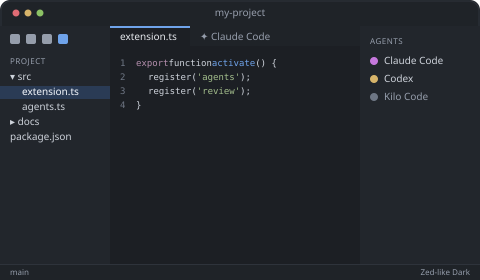

# Apply the Zed layout

**Apply Zed Layout** changes a small, documented set of settings:

- Activity Bar on top, project tree on the left, Secondary Side Bar on the right,
  terminal panel at the bottom (collapsed),
- compact tabs, no minimap, thin scrollbars, custom title bar,
- the **Zed-like Dark** theme and calm typography (configurable in `zedLayout.layout.*` and
  `zedLayout.typography.*`).

Before anything is written you choose **User** or **Workspace** settings and confirm the full
list of changes. The previous values are backed up, so
[Restore Previous Layout](command:zedLayout.restore) brings everything back.

Prefer a separate VS Code profile? Run
[Save Zed Layout as Profile File...](command:zedLayout.profile.save) and import it with
**Profiles: Import Profile...**.
