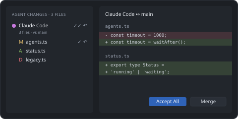

# Review agent changes

The **Agent Changes** view shows the files each session changed compared with its base:

- worktree sessions — everything on the agent branch since it forked from the base branch
  (commits, uncommitted and untracked files),
- other sessions — uncommitted changes of the repository.

Then:

1. **Open All Changes** — every file in one multi-diff editor.
2. **Accept** (stage) or **Reject** (restore the base version) a file, a selection or all files.
3. **Accept All → Commit** and **Merge Agent Branch into Base** to bring a worktree branch back.

Reject cannot be undone — you are always asked to confirm.

[Review Agent Changes](command:zedLayout.review.open)
