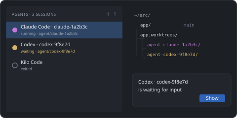

# Start your first agent session

- **New Agent Session** — pick an agent; it starts in a named terminal tab next to your code
  (or in the bottom panel, see `zedLayout.agentSessionLocation`).
- **New Agent Session in Worktree** — creates a `git worktree` on a new branch
  (`agent/<agent>-<id>`) and starts the agent there. Several agents can work in parallel without
  overwriting each other's files.

The **Agents** view lists every session with its status — _starting_, _running_, _waiting_ for
input or _exited_ — and a badge shows how many sessions need your attention. Status detection
uses terminal Shell Integration (bash, zsh, fish, pwsh).

Tip: drag the **Agents** icon to the Secondary Side Bar to keep it on the right, like in Zed.

[Show Agents View](command:workbench.view.extension.zedLayoutAgents)
